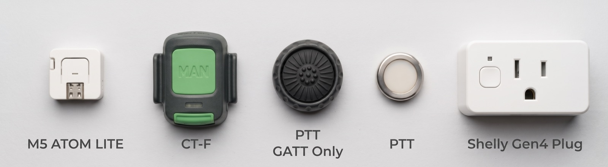
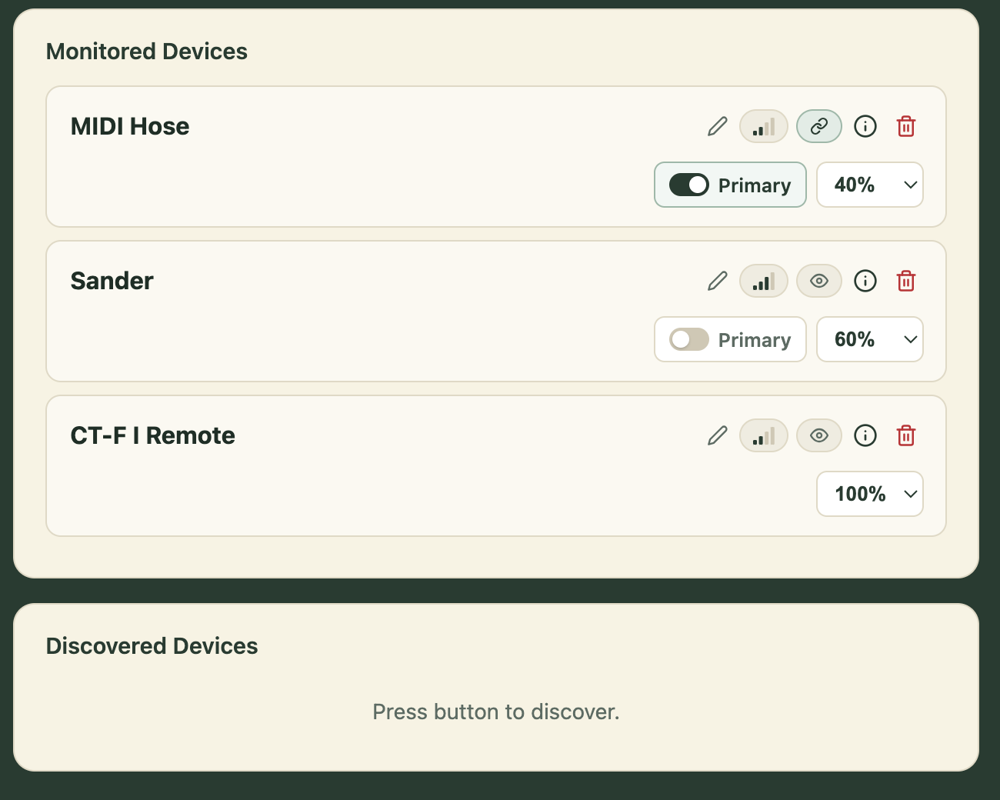

# BLE-Dust-Bridge

A Bluetooth bridge for controlling Festool dust extractors with an M5Stack AtomS3 Lite (ESP32-S3) using Festool CT-F remotes, passive/GATT wireless PTT switches, Festool Bluetooth batteries, and Shelly Gen4 smart plugs.

## Overview & Features

**BLE-Dust-Bridge** turns an ESP32-S3 into a control and automation hub pairing directly to your Festool extractor over standard bluetooth with zero hardware modifications, wiring taps, or extractor firmware alterations:

* **Vibe-coded and presented "As-Is".**

* **100% Non-Invasive Native BLE Pairing:** Connects directly to the extractor using its built-in Bluetooth pairing button and standard BLE protocol—no opening the vacuum, splicing wires, or modifying factory hardware.
* **Automatic Tool On/Off (Shelly Gen4 Plug):** Automatically starts and stops your dust extractor when a corded tool powers on or off through a **Shelly Gen4** smart plug (`shelly_dust_beacon.js`), with a configurable wattage cutoff threshold.
* **Unlimited Passively Monitored Buttons:** Monitor an unlimited number of passive BLE broadcast switches simultaneously without exhausting Bluetooth connection slots—place dedicated switches at every tool station across your shop.
* **Per-Button Preset Suction Speeds:** Assign a custom preset extractor speed to each individual button so every tool station automatically runs at its ideal suction level.
* **Remote Suction Speed Adjustment:** When enabled on the switch toggled as **Primary**, double-tap (`2x`) or triple-tap (`3x`) the primary wireless switch while the extractor is running to step suction speed up or down remotely without walking back to the vacuum.
* **Momentary Press-and-Hold Mode:** When enabled on the switch toggled as **Primary**, the extractor runs only while that primary button is held down and stops immediately upon release.
* **Built-In Web Dashboard & OTA Updates:** Pair devices, assign per-button speeds and switch modes, view live telemetry, and install firmware updates over Wi-Fi via the hosted web UI (`http://dustbridge.local`).
* **Home Assistant & MQTT Ready:** Publishes device states, extractor telemetry, and control topics over MQTT.

## Web UI Preview

## Tested Hardware

The following specific models are hardware verified with **BLE-Dust-Bridge** (other Bluetooth-enabled Festool extractors, Bluetooth battery packs, or compatible passive/GATT BLE buttons may also work, but have not been tested):

| Role | Device / Model | Link |
| :--- | :--- | :--- |
| **Bridge Controller** | M5Stack AtomS3 Lite (ESP32-S3) | [Amazon (`B0D6S1LD1G`)](https://www.amazon.com/dp/B0D6S1LD1G) |
| **Dust Extractor** | Festool CT MIDI I HEPA (`578512`) | [Festool USA (`578512`)](https://www.festoolusa.com/products/dust-extractors/compact-dust-extractors/578512---ct-midi-i-hepa-us) |
| **Wireless Remote** | Festool CT-F I Remote (`578499`) | [Festool USA (`578499`)](https://www.festoolusa.com/accessories/dust-extraction/additions-to-the-system/modules/578499---ct-f-i) |
| **GATT-Only Button** | Wireless PTT Switch (GATT-Only) | [Amazon (`B0GYSGB8DP`)](https://www.amazon.com/dp/B0GYSGB8DP) |
| **Passive / GATT Button** | Wireless PTT Switch (Passive or GATT) | [Amazon (`B0C2DH24FJ`)](https://www.amazon.com/dp/B0C2DH24FJ) |
| **Smart Power Plug** | Shelly Plug US Gen4 | [Amazon (`B0G2YY8TCJ`)](https://www.amazon.com/dp/B0G2YY8TCJ) |

> **Note on choosing a Primary Switch (`CT-F I` vs. `PTT` Buttons):** The **Festool CT-F I (`578499`)** works well as a secondary trigger, but is generally unsuitable as a **primary** switch due to its long internal timeouts between transmissions. For instant response, reliable `2x`/`3x` tap speed stepping, and momentary press-and-hold control, use a dedicated **Passive or GATT PTT switch** as your primary button.

## Web Installer

* **Plug your M5 Atom Lite into your USB port**
* **Go to the web installer at https://core237.github.io/BLE-Dust-Bridge/ and follow the directions**
* **Enjoy**

## Shelly Plug Script

* **Gen4 Power Beacon:** [`shelly/shelly_dust_beacon.js`](shelly/shelly_dust_beacon.js)
